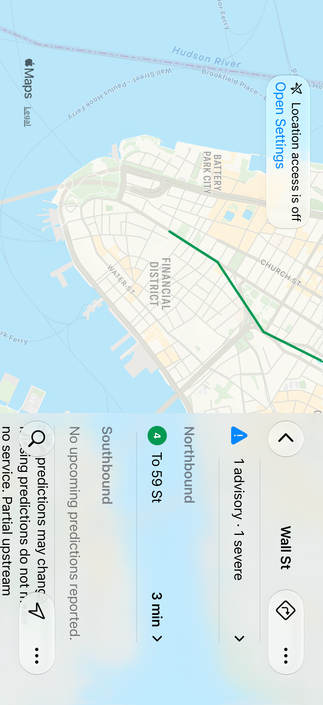

# Native inspector validation — November 9, 2026

The expanded transit controls use SwiftUI's native inspector, with native navigation and bottom toolbars on each pushed screen. The map navigation stack and inspector presenter remain mounted during width changes; geometry closes the column explicitly while the existing compact sheet takes over. Available bounds and accessibility text size choose the presentation. The inspector host uses regular horizontal presentation, while its map and content retain the actual system trait. There is no device-name condition or custom glass background.

## Initial presentation validation

App and test sources: `85751909ab1ba0bc3a410179d8fab55e62ce64ff`, based on main `243c28a3a2af06fc362033d2746cf676f4753ec6`. The subsequent validation-documentation/screenshots commit does not change those sources.

Xcode 27.2 (27B52), iPhone 18 Pro Simulator, iOS 27.2 (24B8117):

- `xcodebuild build analyze test CODE_SIGNING_ALLOWED=NO` passed; **160 unit tests and six UI tests**, zero failures/skips, in `/tmp/SCNativePanelAcceptance.xcresult`.
- A separate same-source focused run passed **two UI tests**, zero failures/skips, in `/tmp/SCNativePanelPresenter.xcresult`.
- The eight UI cases cover station navigation and persistent/unique/hittable trailing controls; Search/Nearby exclusivity and keyboard/query preservation through rotation; expanded menu actions; largest accessibility text using compact presentation; location-granted glance and grouped arrival clock disclosure; route framing, clearing and reselection across layouts; place-route collapse/restore/clear; and expanded station-arrival disclosure.
- Dark-mode acceptance screenshots were exported and visually inspected. The separate focused run also provided inspected light-mode station/search/permission screenshots. Final runs recorded no repeated 60-second animation-completion notification waits. This observation does not establish the cause of unrelated hosted navigation failures or any renderer performance gain.
- SwiftFormat lint passed for all 33 Swift files. No assertion deadlines, scroll-attempt bounds, animation/idling settings, or CI requirements were relaxed. The route-selection helper now requires its activation point above the floating native toolbar before tapping; all route/clear assertions remain.
- Web lint, TypeScript, all **1,059 tests in 98 files**, and production build passed. No web or backend implementation changed.

## Hosted gate and failure-driven revision

The full native run [42682161501](https://github.com/thomashillen/standclear/actions/runs/42682161501/job/129380319383) at `100d006` **did not pass**. It exceeded the 75-minute ceiling: 160 unit tests passed; 47 of 57 UI cases started, with 43 passing, three failing, one interrupted, and ten not started. The failures were expanded place-origin selection, Nearby's repeated-refresh arrival observation, and expanded Museum alternative-route selection. The uploaded result contains Data/Staging but no Info.plist and is not a complete readable xcresult.

Existing raw PNG/video/AX payloads were recovered into separate local files without inventing result metadata. All 814 original artifact files remained hash-identical. The failure frames put the old station activation at `(662, 389.17)` and Museum activation at `(548.2, 327.5)` inside the native controls' common backing container `(512, 320, 300, 82)`. This supports exposing the target before a single tap, but does not establish which handler received either old event. Museum's route-preview root remained present; its missing expected leg was not proof that the whole list disappeared.

The Nearby sample was absent at 20:00:33.438 UTC. Retained app stdout exposed “Waiting for your location…” at 33.597, strongly supporting a real validity-gap presentation. Exact accepted-fix/expiry callbacks were not logged. Nearby/glance now share the existing 25-second coarse one-shot renewal policy, while retaining the hard 30-second expiry, cached-fix guard, permission/error behavior, and background cancellation. A provider returning the same cached fix can still legitimately reach expiry; stale coordinates are not retained.

The shared UI helper now excludes the native bar's complete backing region and keyboard from its activation/drag range. Each of the two failing place activations uses one exposed center tap, with pre-tap frames/screenshots and independent failure-only observations. Scroll bounds, all outcome assertions, and their original deadlines remain unchanged.

The revised app/test source content is recorded at `26397e14f2706e91170715fbac2fcbc30cd8cfa3`. One serial local `build analyze test` passed **160 unit tests plus exactly the three affected UI cases**, zero failures/skips, on iPhone 17 Pro / iOS 26.4.1 (23E254a), built with local Xcode 27.2. Artifacts: `/tmp/SC357FailureRevision.xcresult`, `/tmp/sc357-failure-revision.log`, and `/tmp/sc357-failure-revision-attachments`. Pre-tap screenshots and geometry were inspected. This matches the hosted screen/runtime, not its Xcode 26.6 linked SDK; it does not replace fresh hosted validation.

The job ceiling was raised to 100 minutes based on an initial estimate of about 88.5 minutes. That estimate used 3,982.191 completed UI seconds, about 499 seconds of startup/build/unit overhead, matching historical tail durations and artifact upload. It underestimated the passing workload, including cases that previously failed early; it is not evidence that the full suite fits the budget.

The subsequent full run [42700296932](https://github.com/thomashillen/standclear/actions/runs/42700296932/job/129442906557) at `e07a7ee` also **did not pass**. It hit the 100-minute ceiling: 160 unit tests passed; 48 of 57 UI cases started, with 46 passing, one failing, one interrupted, and nine not started. All three earlier failing UI cases passed. Completed UI work alone consumed 5,307.920 seconds. The new scroll helper repeatedly enumerated broad native toolbar ancestors and queried their collection views; the Museum-transfer case made 255 collection-view existence checks and took 355.879 seconds, compared with 101.612 seconds previously. The follow-up test change applies the existing geometry exclusions before those expensive descendant queries and binds enumerated elements by accessibility identity. Backing-region checks, keyboard exclusion, scroll bounds, and all outcome assertions remain intact; there is no further budget increase.

The one failure was the compact itinerary-framing predicate's original eight-second wait. Its late retained screenshot and AX tree show every required pin correctly framed: map/header boundary y116, sheet top y415 (sheet-header top y430.4), Museum y121.3–156.2, Wall St y323.3–358.2, and transfer y135–169.9. Those observations do not retroactively pass the failed wait or exclude an earlier transient. The log shows repeated shared-bound queries for only two pins before the deadline, with no third-pin query. The follow-up test reads header/sheet/map bounds once per predicate evaluation, keeps all three pin conditions and the eight-second deadline, and retains in-wait geometry separately from late screenshots. The unchanged case passed locally before this observer revision in `/tmp/SC357CompactFramingBefore.xcresult`.

The uploaded second result again lacks Info.plist. Raw screenshot/AX recovery is separate in `/tmp/sc357-e07a7ee-recovered-compact-map`; all 706 original artifact files remained hash-identical. Neither cancelled run qualifies the merge. Fresh exact-head full CI and review remain mandatory.

The subsequent test-observer revision passed local `build analyze test`: **160 unit tests and five affected UI cases**, zero failures/skips, in `/tmp/SC357ObserverRevision.xcresult` (iPhone 17 Pro / iOS 26.4.1, local Xcode 27.2). The cases were expanded place-origin selection (95.829 seconds), compact itinerary framing (32.037), Museum transfer (113.334), Nearby/glance repeated refresh (90.070), and expanded Museum alternatives (95.761). In-wait framing evidence records all three pins satisfying the original bounds. Pre-tap station/Museum geometry and screenshots were inspected; targets remain above the complete native backing region. The Museum-transfer log has 72 collection-view existence checks rather than the retained hosted run's 255; durations across the different environments are not a controlled performance comparison. SwiftFormat lint passed for all 33 files. Application sources and the workflow budget are unchanged by this observer revision. Native framework runtime warnings about `UIKitToolbar`/`_UIReparentingView` under a hosting controller were recorded; the app adds no UIKit bridge or manual subviews. These focused results do not qualify the full hosted gate.

## Complete hosted result and shared geometry observation

Full run [42718309430](https://github.com/thomashillen/standclear/actions/runs/42718309430) at `1c4453e` completed all tests: **216 passed, one failed, zero skipped** (160 units and 56 of 57 UI). Build/test exited 65; the overall job also exceeded its 100-minute ceiling during completion. Both annotations are retained. Its complete readable xcresult, including Info.plist, is at `/tmp/sc357-1c4453e-native-artifact`. The failed case's attachments are separately exported to `/tmp/sc357-1c4453e-largest-attachments`. This run does not qualify the merge.

`testStationRouteChoicesNameInterchangesAtLargestType` failed the original ten-second endpoint-fit wait. About 9.16 seconds elapsed during map existence; header and first-marker existence then retried. No marker-frame or geometry-bound queries occurred before timeout. The same case has a 31-second transfer-element query gap and a 28-second Clear-button lookup gap. The late screenshot shows visible endpoint pins, while the debug attachment contains only a query chain, not measured pin geometry. The unchanged case subsequently passed locally in 88.590 seconds, with zero skips, in `/tmp/SC357LargestEndpointObservation.xcresult`. That local pass does not waive the hosted failure or identify a framework root cause.

Read-only inspection of the retained screen recording adds in-window visual evidence. The map is stable from PTS 323.515 through the inspected original wait (approximately PTS 333–343): boarding, interchange and destination pins remain above the collapsed Steps sheet, without a keyboard or route-list overlay. Visible Show Map and Clear reactions at PTS 322.157 and 372.787 are consistent with the logged event intervals; the conditional video/log offset is −0.263 to +0.057 seconds, not an exact synchronization measurement. Pixels establish visible presentation, not AX frames or existence. Reports and sampled frames are separate under `/tmp/sc357-1c4453e-largest-wait-video` and `/tmp/sc357-1c4453e-video-event-calibration`. The source video SHA256 remained `2e3846c6d18166434bef7a88003618d3e3f0a810e0f0d3f5499686ffc8d6b9d3`.

The next bounded revision changes shared test observation only. Existing first-match map queries use the retained native `Other` identity; marker queries retain mixed types scoped to that map. Endpoint bounds are read once per predicate evaluation. Endpoint, clear and compact-framing predicates retain monotonic query start/end/value records; failure-only hierarchy observations happen after the original failed verdict. The clear helper's short-circuit conditions and zero-marker assertion remain. Keyboard bounds are read once per reveal iteration, preserving the full toolbar-backing exclusions and scroll limit. The original 10/5/8-second deadlines, every geometry inequality, all tests, application sources and workflow budget remain unchanged. This is observation efficiency and instrumentation, not a claimed product or framework fix; fresh exact-head hosted validation and review remain required.

This revision passed local `build analyze test`: **169 passed, zero failed/skipped**, comprising 160 units and nine UI cases in `/tmp/SC357TypedGeometryObserver.xcresult`. Cases cover native inspector adaptation; compact place framing; expanded Museum selection; place-route collapse/restore/clear; station interchanges in compact, expanded and largest-text layouts; temporal train movement/resume; and stale-train removal. The destination was iPhone 17 Pro / iOS 26.4.1, using local Xcode 27.2. Exported records in `/tmp/sc357-typed-geometry-attachments` show both largest-text endpoint frames satisfying every original inequality within the ten-second wait: header bottom y116, map x0–402/y116–788, boarding frame x41.67/y436.33/31.33×34.94, destination x328.67/y183.33/31.33×34.94. That local evaluation completed in about 0.857 seconds; clear subsequently observed the absent button and zero markers within its original five-second wait. The largest-text screenshot was inspected. These are instrumentation/observation qualification results, not a proven app fix or a controlled performance comparison. SwiftFormat lint passed for all 33 files; native framework hosting warnings remain retained. The owned QA simulator was shut down afterward.

## Rendered evidence

These are synthetic fixture predictions and a simulated Times Square location, not live-feed or physical Duo evidence. The operating system supplies the inspector, sheet and toolbar appearance; a full-height inspector can have a subtler material than a compact glance surface.

## Remaining gates

Current-head hosted CI and native Codex review are required before merge. Local passes do not establish the full hosted suite or minimum iOS 26.0 runtime coverage.

A fresh disposable Duo simulator on its dedicated iOS 27.2 runtime failed during data migration and was shut down. The existing Duo simulator and its data were not reset. Actual cover/expanded fold transitions, reserved-region/camera clearance, touch ergonomics, spoken VoiceOver and manual Reduce Motion/Reduce Transparency acceptance still require the physical Duo. This candidate was not installed on the phone.

The original station Back and destination Close investigations remain unresolved. Earlier failed/interrupted local trials are retained separately and are not counted as passing validation.
