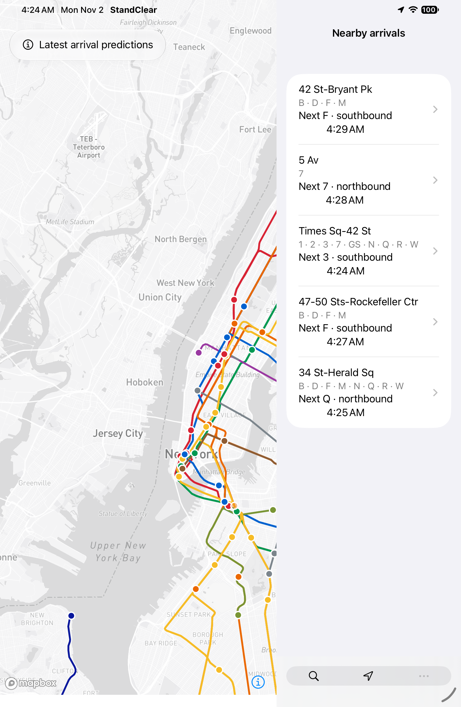
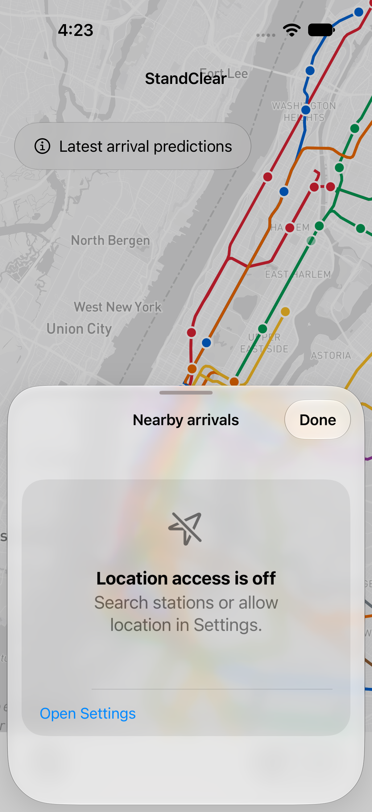
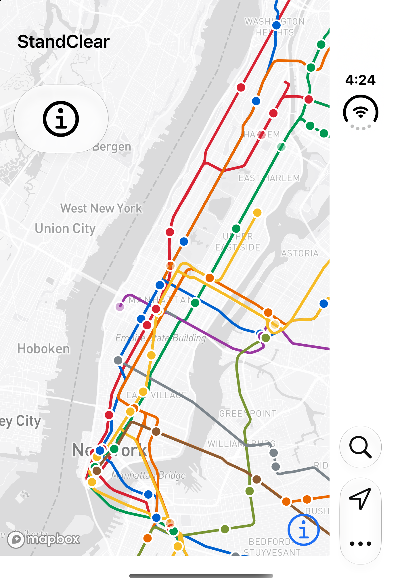

# Native proof-of-concept validation — November 2, 2026

## Executed locally

- Synchronized the existing checkout with `origin/main` (`245e2db`) before implementation; tracked tree clean and exact HEAD match. GitHub authentication, repository push permission, fetch, and a push dry run succeeded. Ignored local configuration was preserved; no `git clean -fdx` used.
- Xcode 27.2 (27B52), iOS Simulator SDK 27.2; Swift 6 language mode with complete strict concurrency.
- SwiftFormat 0.64.5 formatted and linted the native Swift files.
- `xcodebuild build analyze test CODE_SIGNING_ALLOWED=NO` passed on iPhone 18 Pro / iOS 27.2. **20 unit tests and one UI test passed.** No signing team or paid developer membership used.
- Unit tests cover timestamp units/boundaries, expired and stale predictions, trip-only train deduplication, duplicate arrival records, station-complex allowlist/centroid semantics, separate Rector Street stations, nearest-five and outside-NYC handling, train geometry/clamping, coalesced refreshes, cancellation, late responses, and older-snapshot rejection. Network lifecycle tests use controlled URLProtocol responses, not the live service.
- UI test covers native Search and Nearby presentation, mutually exclusive sheets, native denied-permission recovery, dismissal, rotation to the right control region, control placement within the right half of the window, and transfer of open Search/Nearby sheets into the expanded region. Search text survives the transfer. The UI test does not require live network data or a Mapbox token.
- Installed and launched in iPhone 18 Pro, iPhone Duo, and iPad mini (A20 Pro) simulators. Real public endpoints rendered Mapbox tiles, subway lines, train markers, nearby station rows, and arrival predictions using a simulated Times Square location. Screenshots were visually inspected.
- Largest accessibility Dynamic Type and Increased Contrast inspected on the Duo cover display. A status panel that crowded the map was replaced with a standard native status Menu; its accessible label remains available when the visible label becomes an icon at accessibility sizes.
- Web validation passed: `npm run lint`, `npx tsc --noEmit`, `npm test` (**992 tests in 94 files**), and `npm run build` (**971 static pages**). Local Node 26.11.1 differs from CI's Node 24. No web application or server implementation changed.
- Native configuration is ignored; a credential-pattern scan of publishable native source passed. Build results stay outside Git.

The local result bundle is `/tmp/StandClearAdaptiveVerified.xcresult` (full build/analysis/unit/UI run) and `/tmp/StandClearAdaptiveUITest.xcresult` (expanded transfer regression); results are ephemeral and are not committed. CI uploads its own result bundle. The harmless Xcode App Intents metadata warning reflects the absence of an AppIntents dependency.

## Rendered evidence

These are simulator captures of the native application, not web mockups. Arrival predictions reflect the capture time and may change.

## Remaining checks and limits

- Physical Duo folding, cover/expanded transitions, camera clearance, system overlays, real touch behavior, and orientations require Thomas's device testing. The Duo cover display was inspected; the alternate simulator display did not provide a useful active expanded capture. Wide layout was inspected on iPad and asserted on rotated iPhone. These do not establish physical Duo behavior.
- XCTest verifies native labels and semantics; no complete manual VoiceOver session was performed. Test actual reading order, focus, rotor behavior, and permission announcements on device.
- No custom camera/marker animation is used. Reduce Motion and Reduce Transparency use system behavior, but these preferences still need a manual native acceptance pass. Differentiate Without Color adds route text through Mapbox annotations; verify map readability with that preference on device.
- CI results and external review must be checked for the current PR head. Local passes do not imply hosted CI passed or that the app shipped.
- Before distribution, review the Mapbox SDK's bundled privacy manifests, attribution/telemetry controls, native token policy, and native usage allowances for the existing account. No new paid plan or external service was configured in this proof of concept.
